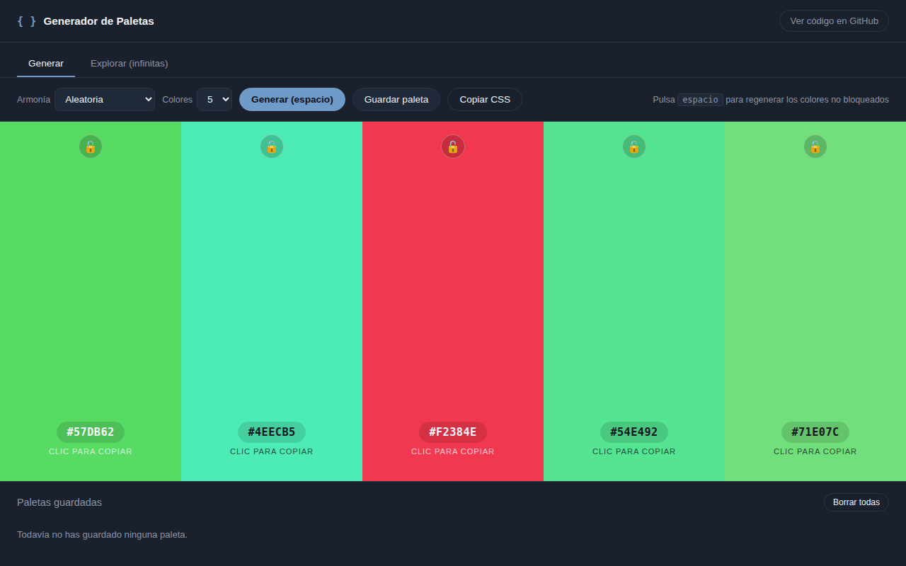
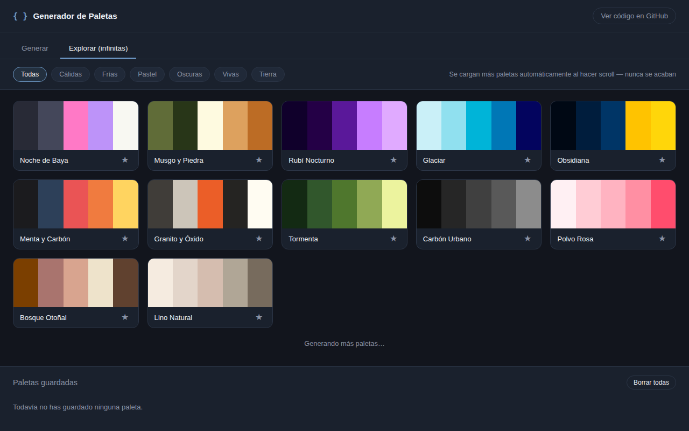

# Generador de Paletas

Herramienta web para generar paletas de color armónicas, explorar una galería infinita de paletas y guardar las favoritas. JavaScript puro — sin frameworks, sin dependencias, sin paso de compilación.

**Demo en vivo:** https://tu-dominio.netlify.app/demo-generador-paletas.html
**Más contexto del proyecto:** https://tu-dominio.netlify.app/proyectos/generador-paletas




## Características

**Generar**
- Paletas de 3 a 7 colores según distintas reglas de armonía: aleatoria, análoga, complementaria, tríada, monocromática y pastel.
- Bloqueo de colores individuales para conservarlos mientras se regeneran el resto.
- Copiar el HEX de un color con un clic, o exportar la paleta completa como variables CSS.
- Atajo de teclado: la barra espaciadora regenera los colores no bloqueados.

**Explorar**
- Galería de scroll infinito que combina una colección curada de paletas reales con generación algorítmica continua — nunca se acaba.
- Filtros por estilo: cálidas, frías, pastel, oscuras, vivas, tierra.
- Guardar cualquier paleta con un clic en la estrella.

**General**
- Paletas guardadas persistentes en `localStorage`, compartidas entre ambas pestañas.
- Sin backend ni API externa: funciona siempre, sin claves ni límites de peticiones de terceros.

## Stack técnico

- HTML5 + CSS3 + JavaScript (ES5, sin build)
- Conversión de color HSL → HEX escrita a mano
- `localStorage` con manejo de errores (try/catch) para navegación privada

## Uso local

Al ser un único archivo HTML sin dependencias, basta con abrirlo directamente:

```bash
# clonar y abrir index.html en el navegador
git clone https://github.com/HookMike/generador-paletas.git
cd generador-paletas
# doble clic en index.html, o:
python3 -m http.server 8000
```

## Por qué está hecho así

Quise demostrar que se puede construir una herramienta pulida y realmente útil sin depender de ningún framework ni servicio externo. La galería "Explorar" podría haber llamado a una API de paletas de terceros, pero eso introduce un punto de fallo (límites de peticiones, caídas del servicio, CORS) en una app que debe funcionar siempre, sin mantenimiento. En su lugar, combina una colección propia de paletas curadas con un generador algorítmico infinito.

## Autor

Miguel Ángel Alonso Valhondo — [LinkedIn](https://www.linkedin.com/in/miguelangel-alonso-valhondo) · [Portfolio](https://tu-dominio.netlify.app)
